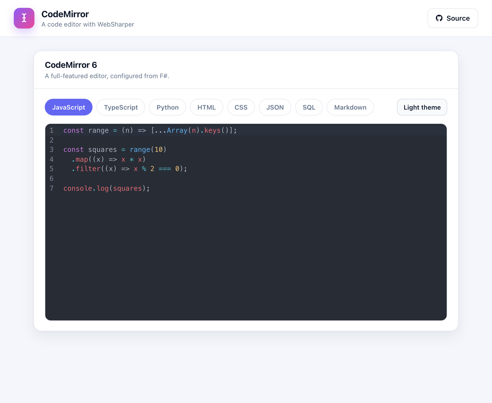

# WebSharper CodeMirror

A [CodeMirror 6](https://codemirror.net/) playground built with
[WebSharper](https://websharper.com) and the
[WebSharper.CodeMirror](https://github.com/dotnet-websharper/codemirror) bindings:
pick a language, edit the snippet, and toggle between the light and dark themes.

[](https://websharper-samples.github.io/CodeMirror)

**[Try it live](https://websharper-samples.github.io/CodeMirror)**

## What it shows

- A full CodeMirror 6 editor configured entirely from F# with
  `EditorView(EditorViewConfig(...))`, `CodeMirror.BasicSetup` and a language
  extension.
- Language support for JavaScript, TypeScript, Python, HTML, CSS, JSON, SQL and
  Markdown, each shipped as an `@codemirror/lang-*` package.
- A theme toggle that recreates the editor with `CodeMirror.OneDark`.

## How it works

- `src/Client.fs` keeps the current language and theme in `Var`s and rebuilds
  the `EditorView` when either changes; the editor mounts into a host element
  via `on.afterRender`.
- CodeMirror and its language packages are bundled from npm by
  [esbuild](https://esbuild.github.io/).

## Running locally

```
dotnet run --project src
```

Then open <http://localhost:5431>.

## Building

```
dotnet build src/CodeMirror.fsproj -c Release
```

## Deployment

Every push to `master` builds in Release and publishes `src/wwwroot` to the
`gh-pages` branch via `.github/workflows/deploy.yml`.
